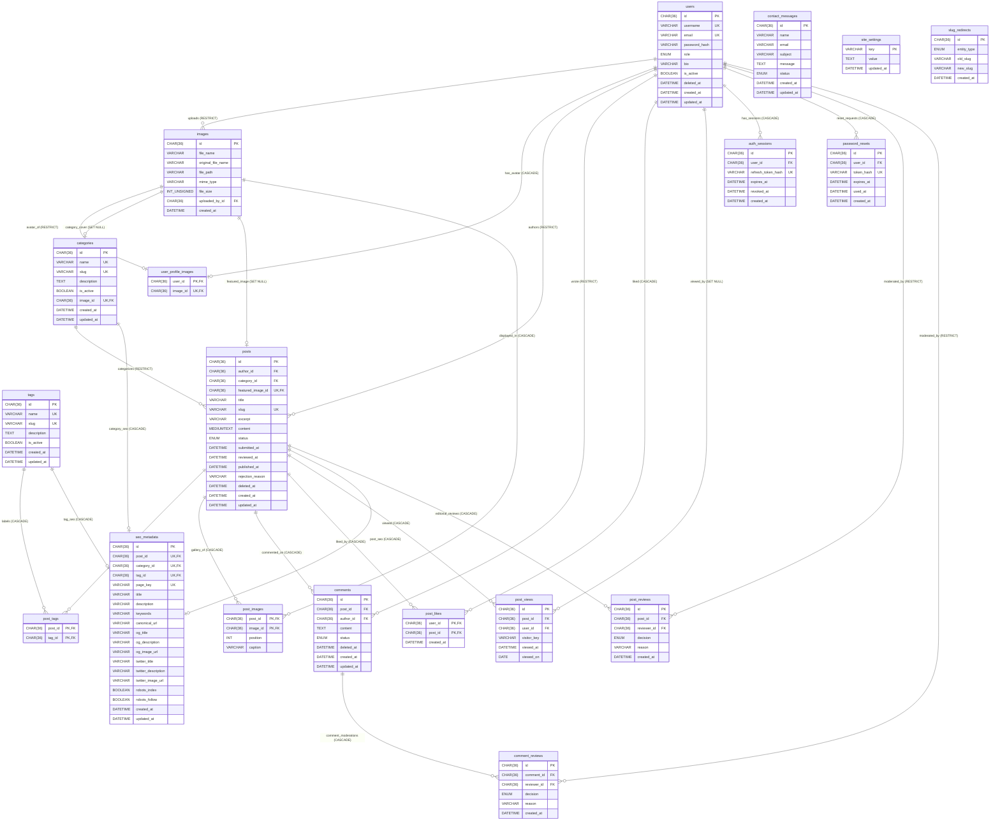

# Blog Management System - Database Entity-Relationship Diagram (ERD)

**Database Engine:** MySQL 8.0+ / MariaDB 10.11+  
**Collation:** `utf8mb4_unicode_ci`  
**Total Tables:** 19  
**Specification Source:** `backend/database/schema.sql`

---

## 1. Complete Visual ER Diagram (Mermaid)

---

## 2. Relational Architecture & Table Specifications

### 2.1 Identity & Access Management

#### `users`
Core user account credentials, roles, and profile information.
- **Primary Key:** `id` (`CHAR(36)` UUID)
- **Unique Keys:** `uq_users_username` (`username`), `uq_users_email` (`email`)
- **Indexes:** `idx_users_role_active` (`role`, `is_active`)
- **Role Enum:** `'USER'`, `'ADMIN'`

#### `auth_sessions`
Active and rotating authentication sessions supporting instant server-side revocation.
- **Primary Key:** `id` (`CHAR(36)` UUID)
- **Foreign Key:** `user_id` -> `users(id)` `ON DELETE CASCADE`
- **Unique Keys:** `uq_auth_sessions_refresh_hash` (`refresh_token_hash`)
- **Indexes:** `idx_auth_sessions_user_expiry` (`user_id`, `expires_at`)

#### `password_resets`
Time-limited password reset tokens.
- **Primary Key:** `id` (`CHAR(36)` UUID)
- **Foreign Key:** `user_id` -> `users(id)` `ON DELETE CASCADE`
- **Unique Keys:** `uq_password_resets_token_hash` (`token_hash`)
- **Indexes:** `idx_password_resets_user_expires` (`user_id`, `expires_at`)

---

### 2.2 Media & Assets

#### `images`
Centralized metadata archive for all uploaded media assets.
- **Primary Key:** `id` (`CHAR(36)` UUID)
- **Foreign Key:** `uploaded_by_id` -> `users(id)` `ON DELETE RESTRICT`
- **Indexes:** `idx_images_uploader_created` (`uploaded_by_id`, `created_at`)

#### `user_profile_images`
One-to-one junction mapping users to their uploaded avatar images.
- **Primary Key:** `user_id` (`CHAR(36)` UUID)
- **Foreign Key 1:** `user_id` -> `users(id)` `ON DELETE CASCADE`
- **Foreign Key 2:** `image_id` -> `images(id)` `ON DELETE RESTRICT`
- **Unique Key:** `uq_user_profile_image` (`image_id`)

---

### 2.3 Taxonomies

#### `categories`
Hierarchical publication sections.
- **Primary Key:** `id` (`CHAR(36)` UUID)
- **Unique Keys:** `uq_categories_name` (`name`), `uq_categories_slug` (`slug`), `uq_categories_image` (`image_id`)
- **Foreign Key:** `image_id` -> `images(id)` `ON DELETE SET NULL`
- **Indexes:** `idx_categories_active_name` (`is_active`, `name`)

#### `tags`
Cross-cutting topical keywords connecting relevant stories.
- **Primary Key:** `id` (`CHAR(36)` UUID)
- **Unique Keys:** `uq_tags_name` (`name`), `uq_tags_slug` (`slug`)
- **Indexes:** `idx_tags_active_name` (`is_active`, `name`)

---

### 2.4 Publications & Content

#### `posts`
Articles, stories, and editorial publications.
- **Primary Key:** `id` (`CHAR(36)` UUID)
- **Unique Keys:** `uq_posts_slug` (`slug`), `uq_posts_featured_image` (`featured_image_id`)
- **Foreign Key 1:** `author_id` -> `users(id)` `ON DELETE RESTRICT`
- **Foreign Key 2:** `category_id` -> `categories(id)` `ON DELETE RESTRICT`
- **Foreign Key 3:** `featured_image_id` -> `images(id)` `ON DELETE SET NULL`
- **Status Enum:** `'DRAFT'`, `'PENDING'`, `'APPROVED'`, `'REJECTED'`
- **Indexes:** 
  - `idx_posts_public` (`status`, `published_at`)
  - `idx_posts_author_status_updated` (`author_id`, `status`, `updated_at`)
  - `idx_posts_category_public` (`category_id`, `status`, `published_at`)

#### `post_tags`
Many-to-many junction connecting posts with tags.
- **Primary Key:** `(post_id, tag_id)`
- **Foreign Key 1:** `post_id` -> `posts(id)` `ON DELETE CASCADE`
- **Foreign Key 2:** `tag_id` -> `tags(id)` `ON DELETE CASCADE`
- **Indexes:** `idx_post_tags_tag_post` (`tag_id`, `post_id`)

#### `post_images`
Many-to-many junction connecting posts with inline gallery image attachments.
- **Primary Key:** `(post_id, image_id)`
- **Foreign Key 1:** `post_id` -> `posts(id)` `ON DELETE CASCADE`
- **Foreign Key 2:** `image_id` -> `images(id)` `ON DELETE CASCADE`
- **Indexes:** `idx_post_images_position` (`post_id`, `position`)

---

### 2.5 Reader Engagement & Analytics

#### `comments`
Reader contributions on published articles.
- **Primary Key:** `id` (`CHAR(36)` UUID)
- **Foreign Key 1:** `post_id` -> `posts(id)` `ON DELETE CASCADE`
- **Foreign Key 2:** `author_id` -> `users(id)` `ON DELETE RESTRICT`
- **Status Enum:** `'PENDING'`, `'APPROVED'`, `'REJECTED'`
- **Indexes:** 
  - `idx_comments_post_status_created` (`post_id`, `status`, `created_at`)
  - `idx_comments_author_created` (`author_id`, `created_at`)

#### `post_likes`
Reader story appreciations.
- **Primary Key:** `(user_id, post_id)`
- **Foreign Key 1:** `user_id` -> `users(id)` `ON DELETE CASCADE`
- **Foreign Key 2:** `post_id` -> `posts(id)` `ON DELETE CASCADE`
- **Indexes:** `idx_post_likes_post_created` (`post_id`, `created_at`)

#### `post_views`
Unique daily reader impressions.
- **Primary Key:** `id` (`CHAR(36)` UUID)
- **Foreign Key 1:** `post_id` -> `posts(id)` `ON DELETE CASCADE`
- **Foreign Key 2:** `user_id` -> `users(id)` `ON DELETE SET NULL`
- **Generated Column:** `viewed_on DATE GENERATED ALWAYS AS (DATE(viewed_at)) STORED`
- **Unique Key:** `uq_post_views_daily_visitor` (`post_id`, `visitor_key`, `viewed_on`)

---

### 2.6 Editorial Review Logs

#### `post_reviews`
Audit log of editorial decisions on submitted posts.
- **Primary Key:** `id` (`CHAR(36)` UUID)
- **Foreign Key 1:** `post_id` -> `posts(id)` `ON DELETE CASCADE`
- **Foreign Key 2:** `reviewer_id` -> `users(id)` `ON DELETE RESTRICT`
- **Decision Enum:** `'APPROVED'`, `'REJECTED'`
- **Indexes:** `idx_post_reviews_post_created` (`post_id`, `created_at`)

#### `comment_reviews`
Audit log of editorial decisions on reader comments.
- **Primary Key:** `id` (`CHAR(36)` UUID)
- **Foreign Key 1:** `comment_id` -> `comments(id)` `ON DELETE CASCADE`
- **Foreign Key 2:** `reviewer_id` -> `users(id)` `ON DELETE RESTRICT`
- **Decision Enum:** `'APPROVED'`, `'REJECTED'`
- **Indexes:** `idx_comment_reviews_comment_created` (`comment_id`, `created_at`)

---

### 2.7 SEO, Navigation & Administration

#### `seo_metadata`
Polymorphic search engine optimization metadata for posts, categories, tags, and static pages.
- **Primary Key:** `id` (`CHAR(36)` UUID)
- **Foreign Key 1:** `post_id` -> `posts(id)` `ON DELETE CASCADE`
- **Foreign Key 2:** `category_id` -> `categories(id)` `ON DELETE CASCADE`
- **Foreign Key 3:** `tag_id` -> `tags(id)` `ON DELETE CASCADE`
- **Unique Keys:** `uq_seo_post` (`post_id`), `uq_seo_category` (`category_id`), `uq_seo_tag` (`tag_id`), `uq_seo_page` (`page_key`)
- **Check Constraint:** `chk_seo_single_owner` ensures exactly one parent owner is associated per record.

#### `slug_redirects`
Historical slug transition tracking providing HTTP 301 permanent redirects.
- **Primary Key:** `id` (`CHAR(36)` UUID)
- **Unique Key:** `uq_slug_redirect_source` (`entity_type`, `old_slug`)
- **Indexes:** `idx_slug_redirect_target` (`entity_type`, `new_slug`)
- **Entity Type Enum:** `'POST'`, `'CATEGORY'`, `'TAG'`

#### `contact_messages`
Inbound reader inquiries submitted via public `/contact` form.
- **Primary Key:** `id` (`CHAR(36)` UUID)
- **Status Enum:** `'NEW'`, `'READ'`, `'RESOLVED'`
- **Indexes:** `idx_contact_status_created` (`status`, `created_at`)

#### `site_settings`
Global database-backed key-value registry.
- **Primary Key:** `key` (`VARCHAR(100)`)
- **Data Columns:** `value` (`TEXT`), `updated_at` (`DATETIME(3)`)
